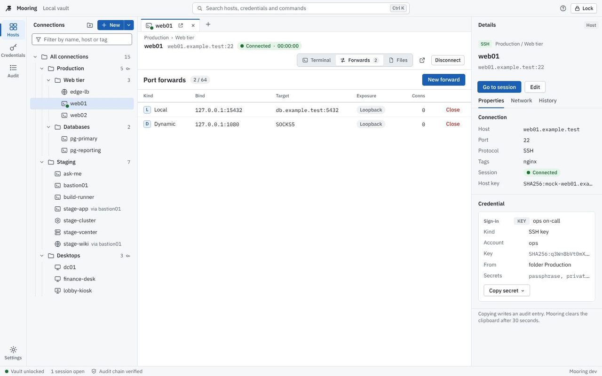
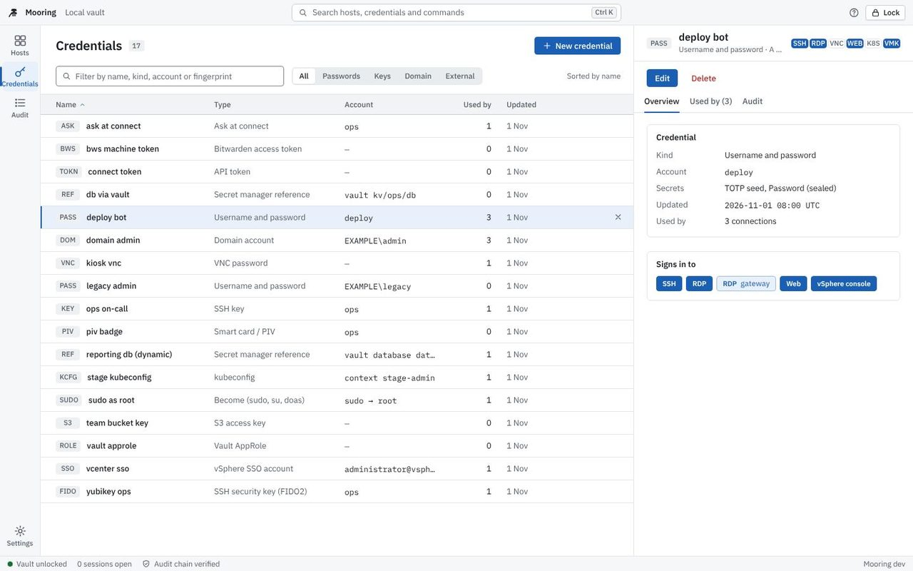
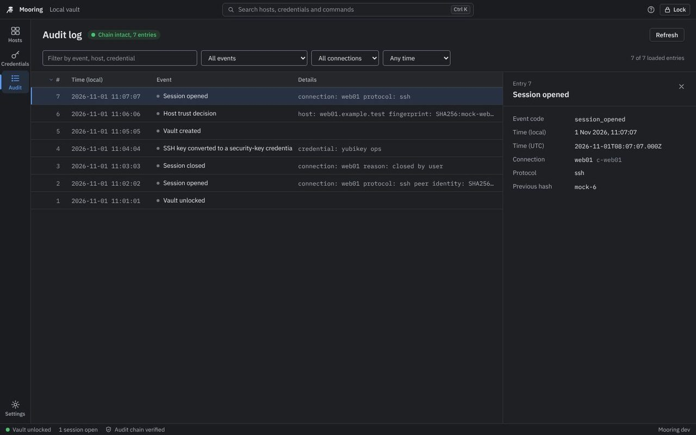
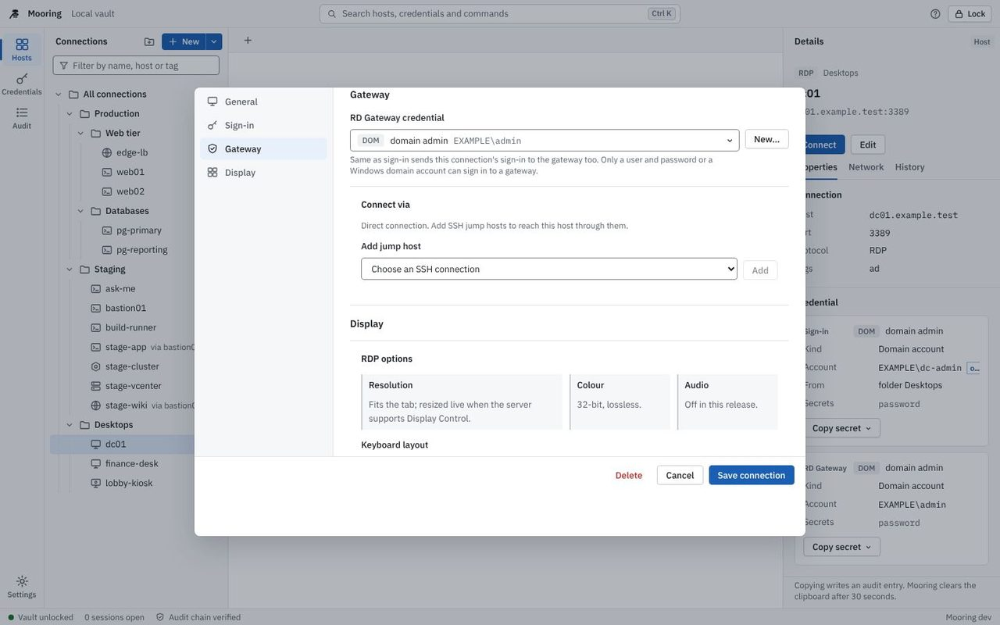
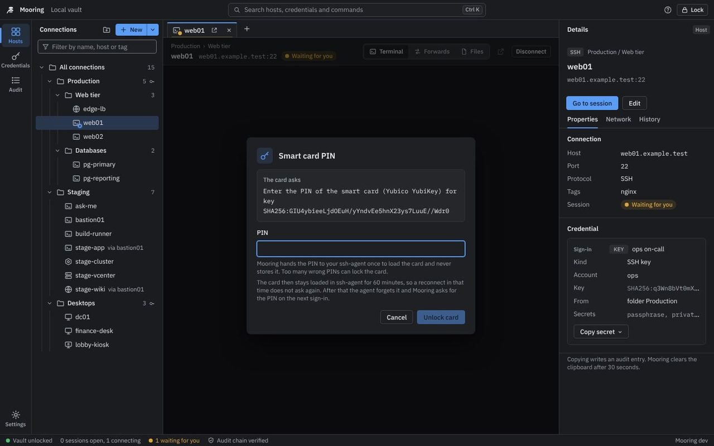
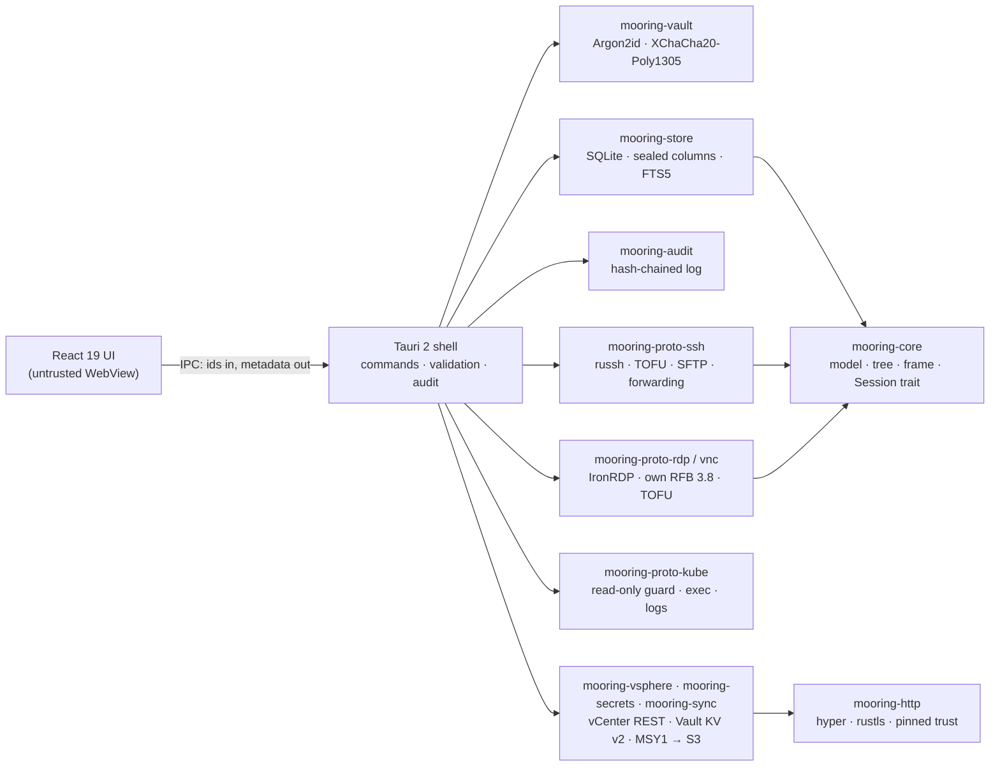

# Mooring — Secure Remote Access Manager for SSH, RDP, VNC, Kubernetes and vSphere

**One encrypted vault and one keyboard-first window for every server, desktop and cluster you
administer. Open source, cross-platform, built in Rust.**

[](LICENSE)
[](https://github.com/yyasar21/Mooring/actions/workflows/ci.yml)
[](https://github.com/yyasar21/Mooring/actions/workflows/security.yml)
[](https://github.com/yyasar21/Mooring/actions/workflows/test-vectors.yml)
[](https://github.com/yyasar21/Mooring/releases)
[](#install)
[](https://www.rust-lang.org/)
[](https://tauri.app/)

<picture>
  <source media="(prefers-color-scheme: dark)" srcset="docs/assets/screenshots/hero-dark.jpg">
  
</picture>

> **Project status: v0.2.0 in release (Phase A5).** On top of v0.1.0 (Phase A, released
> 2026-11-07), `main` adds jump hosts, RD Gateway, FIDO2 security keys and PIV smart cards for
> SSH, Touch ID / Windows Hello unlock, encrypted backup export and import, dynamic Vault
> secrets, 1Password Connect and Bitwarden Secrets Manager, and the new "Harbor" interface,
> after nine security reviews. The v0.2.0 tag waits for the per-OS manual gates. Installers
> carry Sigstore-signed checksums and build provenance; they are not notarized or
> Authenticode-signed yet (no certificates). Downloads: the
> [releases page](https://github.com/yyasar21/Mooring/releases/latest).

## Contents

- [Why Mooring](#why-mooring)
- [Features](#features)
- [How Mooring compares](#how-mooring-compares)
- [Install](#install)
- [Quick start](#quick-start)
- [Screenshots](#screenshots)
- [Architecture](#architecture)
- [Security model](#security-model)
- [Contributing](#contributing)
- [AI-assisted development](#ai-assisted-development)
- [License](#license)

## Why Mooring

A remote-access manager holds the keys to everything you run. Mooring treats that as the
design constraint, not an afterthought:

- **Strong vault cryptography.** Your master password is stretched with **Argon2id**
  (memory cost calibrated to your machine, about 500 ms per unlock). The resulting key wraps
  a random data key, and every secret field is sealed separately with
  **XChaCha20-Poly1305**. ([ADR-0002](docs/adr/0002-vault-cryptography.md))
- **Or keep secrets out of Mooring entirely.** Point a credential at **HashiCorp Vault,
  OpenBao, 1Password Connect or Bitwarden Secrets Manager** and Mooring reads the password, SSH
  key or kubeconfig at connect time, holds it only for the handshake and never writes it
  anywhere. Vault can also issue short-lived database credentials and SSH certificates per
  session. ([setup guide](docs/user-guide/external-secrets.md))
- **Hardware-backed sign-in.** FIDO2 security keys and PIV smart cards sign through your
  ssh-agent, with a touch prompt or a PIN that is never stored, and never fall back to a
  password. ([guide](docs/user-guide/security-keys-and-smart-cards.md))
- **Per-field AEAD.** Each sealed value is bound to its record and field name. A secret
  copied into another row or column fails to decrypt instead of leaking.
- **Tamper-evident audit log.** Unlocks, locks, credential use, password copies, host-key
  decisions and sessions are written to a SHA-256 hash-chained log you can verify in the app.
- **Strict SSH algorithm policy.** Only modern key exchange, host-key, cipher and MAC
  algorithms are offered. No SHA-1, no CBC, no `ssh-rsa`, no DSA; Terrapin strict-kex is on.
  ([ADR-0007](docs/adr/0007-ssh-trust-and-algorithms.md))
- **TOFU with a hard stop.** New host keys need your explicit approval with the SHA-256
  fingerprint shown. A changed host key ends the connection with no "continue anyway" button,
  the same model as OpenSSH. The same rule covers RDP certificates, RD Gateway certificates and
  every jump host in a chain.
- **Zeroized secrets.** Keys and decrypted secrets live in zeroizing memory, are dropped on
  lock and never cross into the user interface, logs or error messages. The UI only ever sees
  credential IDs. ([ADR-0003](docs/adr/0003-trust-boundaries.md))
- **Memory-safe core.** Every Rust crate is built with `#![forbid(unsafe_code)]`. Crypto
  comes only from RustCrypto and `ring`; parsers for untrusted input are capped and
  property-tested.
- **Open and auditable.** MIT licensed, public threat model, public architecture decision
  records, security reviews committed to the repository.

## Features

Legend: ✅ available on `main` · 🗓 planned (see [roadmap](docs/roadmap.md)). Items marked
**New** arrive with v0.2.0.

| Area | Feature | Status |
| --- | --- | --- |
| Vault | Create, unlock, lock, change master password; Argon2id cost calibrated to the host | ✅ |
| Vault | Auto-lock on idle, sleep, screen lock and hidden window; external forwards, tokens and leases dropped on lock | ✅ |
| Vault | **New:** unlock with Touch ID / Windows Hello (opt-in, biometric ACL; Touch ID needs a Developer-ID-signed build; not on Linux) | ✅ [ADR-0022](docs/adr/0022-biometric-unlock.md) |
| Vault | **New:** encrypted backup export and import (`age`, separate passphrase, merge with conflict report or replace) ([guide](docs/user-guide/backup-and-restore.md)) | ✅ [ADR-0023](docs/adr/0023-vault-export-import-ui.md) |
| Vault | Encrypted vault sync to S3-compatible storage (three-way merge, fork/rollback hard stops, join flow) | ✅ [ADR-0017](docs/adr/0017-vault-sync-and-signin.md) |
| Organise | Folder tree with drag-and-drop, tags, full-text search; credential inheritance with per-connection override | ✅ |
| Organise | Command palette: connections, recent connections, actions and settings pages | ✅ |
| Credentials | Typed model with 20 kinds (passwords, domain users, SSH keys, agent, certificates, tokens, kubeconfig, TOTP, AppRole, S3, external references, security keys, smart cards…) | ✅ [ADR-0009](docs/adr/0009-credential-model.md) |
| Credentials | Copy password to clipboard, cleared after 30 s and on lock, audited | ✅ |
| SSH | Terminal (xterm.js + WebGL); password, public key, keyboard-interactive, ssh-agent; certificates | ✅ |
| SSH | Host-key TOFU, OpenSSH `known_hosts` compatible, mismatch hard stop | ✅ |
| SSH | Local, remote and dynamic (SOCKS5) forwarding with audited exposure; SFTP with local paths picked in Rust | ✅ |
| SSH | **New:** FIDO2 security keys (`sk-*`) and PIV smart cards through ssh-agent, touch prompt, PIN never stored ([guide](docs/user-guide/security-keys-and-smart-cards.md)) | ✅ [ADR-0024](docs/adr/0024-fido2-ssh-keys.md) |
| Network | **New:** jump hosts: up to three SSH hops for SSH, SFTP, RDP, VNC and Kubernetes, per-hop trust and credentials; web sessions through a SOCKS proxy on Windows and Linux ([guide](docs/user-guide/jump-hosts.md)) | ✅ [ADR-0025](docs/adr/0025-jump-hosts.md) |
| RDP | IronRDP with NLA/CredSSP, certificate TOFU, dynamic resolution, clipboard | ✅ [ADR-0011](docs/adr/0011-rdp-session.md) |
| RDP | **New:** RD Gateway (MS-TSGU over WebSocket, NTLM with channel binding, own pin store) ([guide](docs/user-guide/rd-gateway.md)) | ✅ [ADR-0027](docs/adr/0027-rd-gateway-and-smart-card.md) |
| VNC | RFB 3.8, Tight/ZRLE, VeNCrypt TLS, view-only mode | ✅ [ADR-0012](docs/adr/0012-vnc-session.md) |
| Web | Isolated web sessions per connection (own window, partitioned storage, navigation policy) | ✅ [ADR-0013](docs/adr/0013-web-sessions.md) |
| vSphere | Inventory sync into a read-only folder, scheduled refresh, VM power state and opt-in power actions, vSphere Client / VMRC consoles | ✅ [ADR-0015](docs/adr/0015-vsphere-integration.md) |
| Kubernetes | Contexts from kubeconfig or token, pod list, RBAC self-review, `exec` shells, logs, port-forward on a closed read-only route list | ✅ [ADR-0014](docs/adr/0014-kubernetes-sessions.md) |
| Secrets | HashiCorp Vault / OpenBao KV v2 (token, AppRole or OIDC sign-in), fetched at connect time and never stored ([guide](docs/user-guide/external-secrets.md)) | ✅ [ADR-0016](docs/adr/0016-external-secrets.md) |
| Secrets | **New:** dynamic Vault engines (database, SSH sign and OTP, PKI) with lease renew/revoke; 1Password Connect; Bitwarden Secrets Manager via `bws` | ✅ [ADR-0026](docs/adr/0026-dynamic-secrets-1password-bitwarden.md) |
| Audit | Hash-chained audit log with chain verification; **new:** filters by text, event, connection and time, and an entry detail panel | ✅ |
| Audit | RFC 5424 syslog mirror (UDP/TCP/TLS) with chain hash, heartbeat and redirect audit | ✅ |
| UI | **New:** "Harbor" interface: navigation rail, session header, inspector tabs, data tables, dark and light themes checked for WCAG AA contrast, keyboard-first | ✅ |
| Import | Royal TS, Remote Desktop Manager, Termius, mRemoteNG, PuTTY, OpenSSH `~/.ssh/config`; Active Directory / OpenLDAP computers over LDAPS — all into a dry-run plan ([guide](docs/user-guide/importing.md)) | ✅ [ADR-0019](docs/adr/0019-importers-and-onboarding.md) |
| Tools | TCP port check, ping, traceroute, read-only WireGuard status from the inspector (fixed paths, no shell, capped output) | ✅ [ADR-0020](docs/adr/0020-network-tools.md) |
| Release | dmg/pkg, exe/msi, deb/rpm/AppImage and portable zips with cosign-signed checksums, SBOM, SLSA provenance and a reproducible-build check; Homebrew tap | ✅ [ADR-0018](docs/adr/0018-release-v0-1-0.md) |
| Release | In-app updater: on-demand checks, packages signed with the project key and verified before install ([guide](docs/user-guide/updates.md)) | ✅ |
| Release | **New:** builds that are not releases run as "Mooring Dev" with separate data; macOS "Move to Applications" | ✅ [ADR-0028](docs/adr/0028-build-identity-and-macos-install-hygiene.md) |
| Release | Notarized / Authenticode-signed installers and the winget listing (jobs and manifests are ready, waiting for certificates) | 🗓 |
| QA | 66 cargo-fuzz targets (protocol parsers, kubeconfig, API responses, sync and backup documents, import formats, LDAP BER, RD Gateway packets) + nightly | ✅ |

## How Mooring compares

Mooring is young; the established tools below do much more today. This table is here to help
you decide whether Mooring fits your needs, based on each vendor's public documentation as of
November 2026. Check the vendor's site for current details.

| | Mooring | Royal TS / TSX | Devolutions RDM | mRemoteNG | Termius |
| --- | --- | --- | --- | --- | --- |
| License | MIT, open source | Proprietary | Proprietary | GPL-2.0, open source | Proprietary |
| Price | Free | Paid; free edition with limits | Paid; free edition | Free | Freemium, paid tiers |
| macOS | ✅ | ✅ (Royal TSX) | ✅ | — | ✅ |
| Windows | ✅ | ✅ | ✅ | ✅ | ✅ |
| Linux | ✅ | — | ✅ | — | ✅ |
| Mobile | — | ✅ | ✅ | — | ✅ |
| SSH | ✅ | ✅ | ✅ | ✅ | ✅ |
| RDP / VNC | ✅ | ✅ | ✅ | ✅ | — |
| VMware vSphere console | ✅ | ✅ | ✅ | — | — |
| SSH jump hosts | ✅ | ✅ | ✅ | — | ✅ |
| RD Gateway | ✅ | ✅ | ✅ | ✅ | — |
| Team sharing | Encrypted multi-device sync (S3) | ✅ | ✅ | Via shared file | ✅ |
| Public source code | ✅ | — | — | ✅ | — |
| Public threat model and security reviews | ✅ | — | — | — | — |

Mooring targets all three desktop platforms from one codebase.
Mooring's angle is narrow on purpose: a single-user, local-first vault with documented
cryptography, an auditable Rust core and no account or cloud service required.

## Install

Installers for every platform are on the [releases page](https://github.com/yyasar21/Mooring/releases/latest), with Sigstore-signed checksums and build provenance; they are not notarized or Authenticode-signed yet (macOS shows the Gatekeeper warning once — right-click → Open; Windows SmartScreen → More info → Run anyway), or [build from source](#build-from-source).
Release details and verification steps live in [docs/release.md](docs/release.md).

| OS | Package | Command / file |
| --- | --- | --- |
| macOS 12+ (Apple silicon and Intel) | Homebrew cask | `brew install --cask yyasar21/mooring/mooring` |
| macOS | Disk image / installer | `Mooring_<version>_universal.dmg`, `.pkg` |
| Windows 10/11 | Installer | `Mooring_<version>_x64-setup.exe`, `.msi` |
| Windows | Portable (no install, no admin) | `Mooring_<version>_x64_portable.zip` — unzip anywhere, keep `portable` next to `Mooring.exe`; data in `Mooring Data\` ([guide](docs/user-guide/getting-started.md#portable-build-no-installer-no-admin)) |
| macOS | Portable | `Mooring_<version>_universal_portable.zip` — same, next to `Mooring.app` |
| Windows | winget | `winget install --id yyasar21.Mooring` once the package is listed (submission waits for signed installers; [details](docs/user-guide/getting-started.md#windows-winget)) |
| Debian, Ubuntu | Package | `sudo apt install ./mooring_<version>_amd64.deb` |
| Fedora, RHEL | Package | `sudo dnf install ./mooring-<version>.x86_64.rpm` |
| Any Linux | AppImage | `chmod +x Mooring_<version>_amd64.AppImage && ./Mooring_<version>_amd64.AppImage` |

Every release ships `SHA256SUMS` signed with Sigstore (cosign keyless), SLSA build provenance and a
CycloneDX SBOM; in-app update packages are signed with the project's updater key and verified
before install. The first releases are **not** notarized or Authenticode-signed (no certificates
yet) — see [docs/release.md](docs/release.md) for how to verify a download. See
[SECURITY.md](SECURITY.md).

### Build from source

You need Rust 1.89+, Node.js 22+, pnpm 10 and the Tauri 2 system prerequisites for your OS
(full per-OS commands in the [build guide](docs/developer-guide/building.md)).

```bash
git clone https://github.com/yyasar21/Mooring.git
cd Mooring
make setup   # once: rust components, cargo tools, pnpm dependencies, git hooks
make dev     # run the desktop app
make bundle  # unsigned local installers in target/release/bundle
```

## Quick start

1. **Create your vault.** On first launch, choose a master password of at least 12
   characters. Mooring calibrates Argon2id to your machine; there is no recovery, so store the
   password somewhere safe.
2. **Add a folder and a credential.** Use the folder and key icons above the connection tree.
   A credential set as a folder default is inherited by every connection inside it.
3. **Add an SSH connection.** Click *New connection*, enter a name and host
   (for example `web01.example.test`), keep *Inherit from folder* for the credential.
4. **Connect and verify the host key.** Press `Ctrl+K` (`⌘K` on macOS), type the name, press
   `Enter`. Compare the SHA-256 fingerprint with the one from your server, then
   *Trust and connect*.
5. **Lock when you leave.** `Ctrl+Shift+L` (`⌘⇧L`) locks the vault; open sessions keep
   running, new ones need the password. Review what happened under *Audit log*.

The [user guide](docs/user-guide/README.md) covers each step in detail.
Coming from another tool? See [Importing connections](docs/user-guide/importing.md).

## Screenshots

| | |
| --- | --- |
|  |  |
| Credentials with a detail page (light) | Audit log filters and entry details (dark) |
|  |  |
| Connection dialog: RD Gateway and jump hosts (light) | Smart card PIN prompt (dark) |

Screenshots were taken against the UI's mock backend with demo data and `example.test` hosts.

## Architecture



The UI is treated as untrusted: it calls a fixed set of validated commands and never receives
a secret. Read the [architecture overview](docs/developer-guide/architecture.md) for details.

## Security model

- Threat model: [docs/security/threat-model.md](docs/security/threat-model.md) (attackers,
  STRIDE mitigations, accepted risks).
- Decisions: [docs/adr/](docs/adr/) — vault cryptography, trust boundaries, storage, SSH trust,
  IPC contract, credential model, RDP/VNC, web sessions, Kubernetes, vSphere, external secrets,
  vault sync, biometric unlock, backups, security keys, jump hosts, dynamic secrets, RD Gateway.
- Reviews: [docs/security/](docs/security/) — every phase ends with a written security review.
- Plain-language summary: [Vault and security model](docs/user-guide/vault-and-security.md).
- Reporting a vulnerability: [SECURITY.md](SECURITY.md). Please do not open public issues.

Every pull request runs `cargo-deny`, `cargo-audit`, `pnpm audit`, gitleaks and Semgrep, and
the vault format is pinned by test vectors verified with the reference `age` CLI.

## Contributing

Contributions are welcome — bug reports, documentation, tests and code. Start with
[CONTRIBUTING.md](CONTRIBUTING.md) and the [developer guide](docs/developer-guide/README.md).
Please follow the [Code of Conduct](CODE_OF_CONDUCT.md).

- Documentation index: [docs/README.md](docs/README.md)
- Roadmap: [docs/roadmap.md](docs/roadmap.md)
- Changelog: [CHANGELOG.md](CHANGELOG.md)
- Questions and ideas: [GitHub Discussions](https://github.com/yyasar21/Mooring/discussions)

## AI-assisted development

Mooring is written with AI coding agents (Claude Code) working in defined roles — architect,
Rust core, UI, QA, security reviewer, release engineer — under the direction of a human
maintainer who approves every decision and merge. The process is documented in
[AI-assisted development workflow](docs/developer-guide/ai-assisted-workflow.md). Every change
passes the same gates as human code: tests, lints, dependency and secret scanning, and a
written security review. The ADRs, reviews and handoff notes in `docs/` are the audit trail.

## License

[MIT](LICENSE) © Yunus Yaşar

## About this project

Mooring is an open source **remote desktop manager** and **SSH client** for macOS, Windows
and Linux, built with **Rust** and **Tauri**. It aims to be a security-focused
**Royal TS alternative** and **Remote Desktop Manager alternative**: one place for **SSH**
(with jump hosts, FIDO2 security keys and smart cards), an **RDP client** with RD Gateway,
**VNC**, isolated web consoles, **Kubernetes** shells and **vSphere** consoles — with an
encrypted credential vault, a tamper-evident audit log and no account or cloud service
required.
