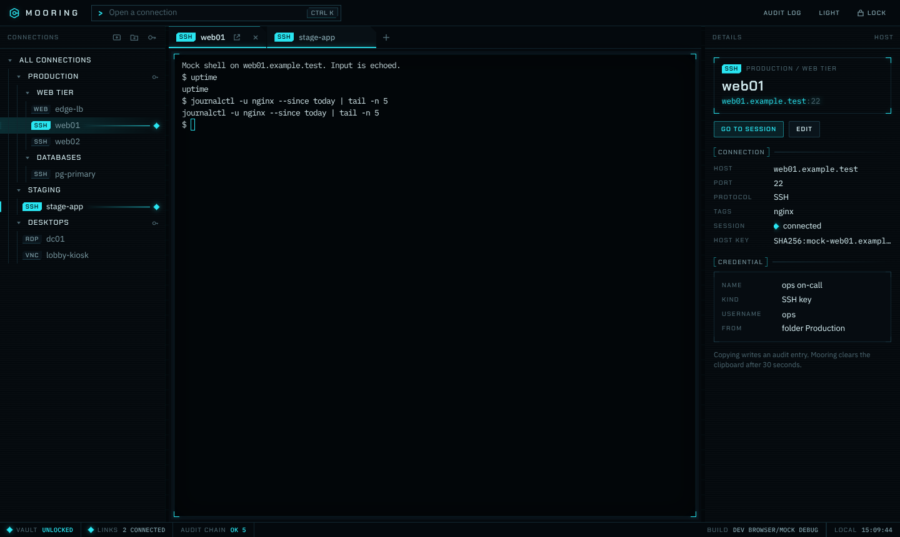
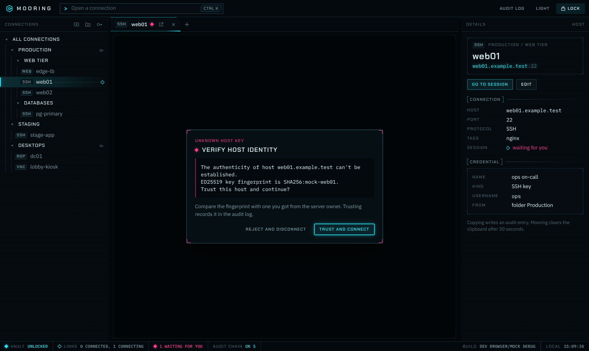
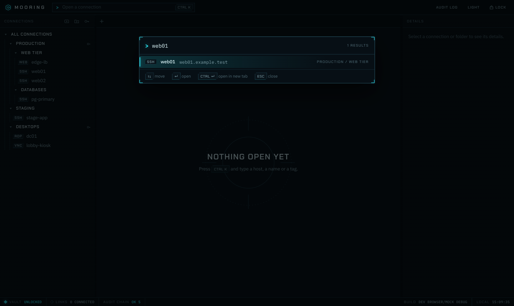
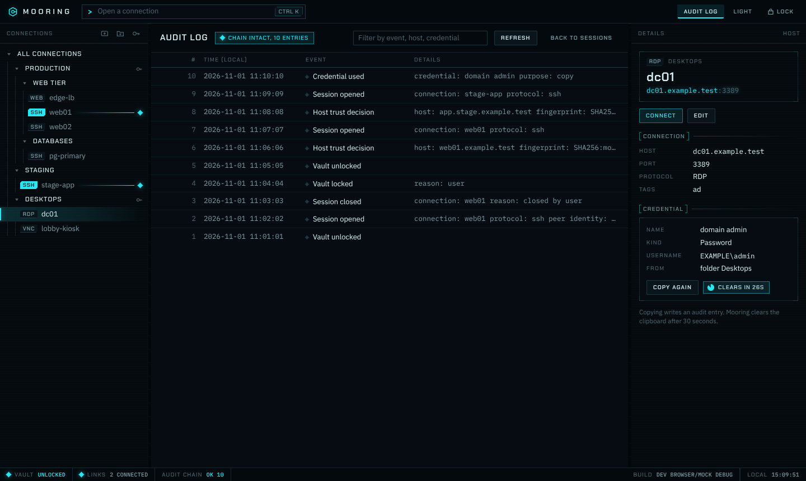
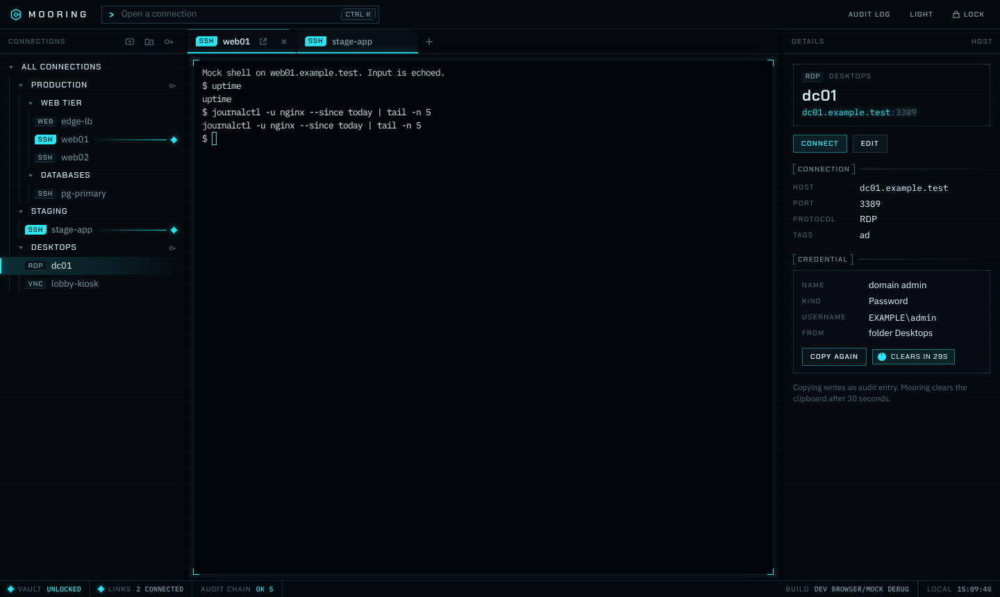
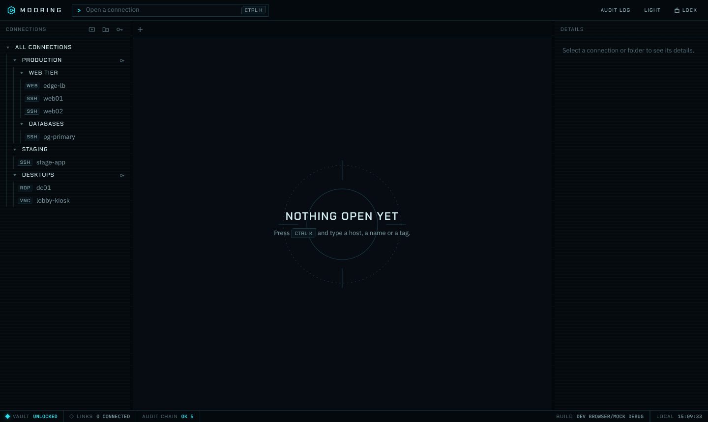
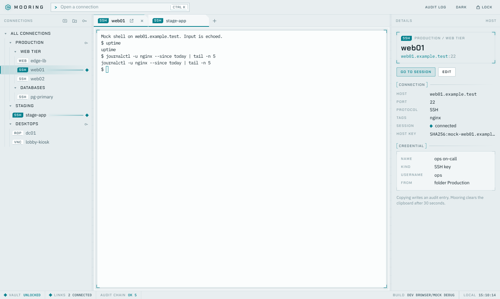
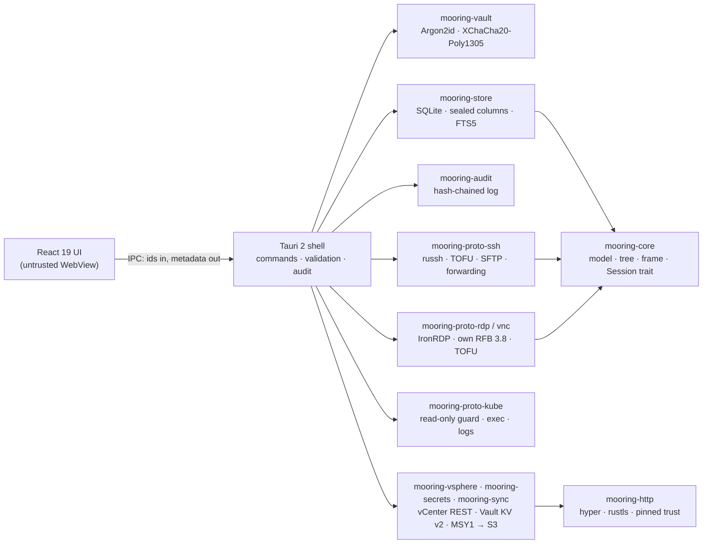

# Mooring — Secure Remote Access Manager for SSH, RDP, VNC, Kubernetes and vSphere

**One encrypted vault and one keyboard-first window for every server, desktop and cluster you
administer. Open source, cross-platform, built in Rust.**

[](LICENSE)
[](https://github.com/yyasar21/Mooring/actions/workflows/ci.yml)
[](https://github.com/yyasar21/Mooring/actions/workflows/security.yml)
[](https://github.com/yyasar21/Mooring/actions/workflows/test-vectors.yml)
[](https://github.com/yyasar21/Mooring/releases)
[](#install)
[](https://www.rust-lang.org/)
[](https://tauri.app/)



> **Project status: pre-release (Phases A1–A3 complete; A4 = release v0.1.0 in progress).**
> The encrypted vault, connection tree, typed credentials, SSH / RDP / VNC / isolated web
> sessions, read-only Kubernetes sessions, vSphere inventory sync with VM power and consoles,
> HashiCorp Vault / OpenBao secret references, encrypted vault sync to S3, auto-lock, the audit
> log and its syslog mirror all work on `main` and have passed six security reviews. Signed
> installers, importers and the auto-updater are on the [roadmap](docs/roadmap.md) for v0.1.0.
> Pre-release builds are on the [releases page](https://github.com/yyasar21/Mooring/releases).

## Contents

- [Why Mooring](#why-mooring)
- [Features](#features)
- [How Mooring compares](#how-mooring-compares)
- [Install](#install)
- [Quick start](#quick-start)
- [Screenshots](#screenshots)
- [Architecture](#architecture)
- [Security model](#security-model)
- [Contributing](#contributing)
- [AI-assisted development](#ai-assisted-development)
- [License](#license)

## Why Mooring

A remote-access manager holds the keys to everything you run. Mooring treats that as the
design constraint, not an afterthought:

- **Strong vault cryptography.** Your master password is stretched with **Argon2id**
  (memory cost calibrated to your machine, about 500 ms per unlock). The resulting key wraps
  a random data key, and every secret field is sealed separately with
  **XChaCha20-Poly1305**. ([ADR-0002](docs/adr/0002-vault-cryptography.md))
- **Or keep secrets out of Mooring entirely.** Point a credential at **HashiCorp Vault or
  OpenBao** and Mooring reads the password, SSH key or kubeconfig at connect time, holds it only
  for the handshake and never writes it anywhere. ([setup guide](docs/user-guide/external-secrets.md))
- **Per-field AEAD.** Each sealed value is bound to its record and field name. A secret
  copied into another row or column fails to decrypt instead of leaking.
- **Tamper-evident audit log.** Unlocks, locks, credential use, password copies, host-key
  decisions and sessions are written to a SHA-256 hash-chained log you can verify in the app.
- **Strict SSH algorithm policy.** Only modern key exchange, host-key, cipher and MAC
  algorithms are offered. No SHA-1, no CBC, no `ssh-rsa`, no DSA; Terrapin strict-kex is on.
  ([ADR-0007](docs/adr/0007-ssh-trust-and-algorithms.md))
- **TOFU with a hard stop.** New host keys need your explicit approval with the SHA-256
  fingerprint shown. A changed host key ends the connection with no "continue anyway" button,
  the same model as OpenSSH.
- **Zeroized secrets.** Keys and decrypted secrets live in zeroizing memory, are dropped on
  lock and never cross into the user interface, logs or error messages. The UI only ever sees
  credential IDs. ([ADR-0003](docs/adr/0003-trust-boundaries.md))
- **Memory-safe core.** Every Rust crate is built with `#![forbid(unsafe_code)]`. Crypto
  comes only from RustCrypto and `ring`; parsers for untrusted input are capped and
  property-tested.
- **Open and auditable.** MIT licensed, public threat model, public architecture decision
  records, security reviews committed to the repository.

## Features

Legend: ✅ available on `main` · 🚧 in progress · 🗓 planned (see [roadmap](docs/roadmap.md))

| Area | Feature | Status |
| --- | --- | --- |
| Vault | Create, unlock, lock, change master password | ✅ |
| Vault | Argon2id cost calibrated to the host, parameters authenticated in the header | ✅ |
| Vault | Auto-lock on idle, sleep, screen lock and hidden window; external forwards closed on lock | ✅ |
| Vault | Unlock with Touch ID / Windows Hello (opt-in) | 🚧 |
| Vault | Portable backup readable with the `age` CLI (library done, command pending) | 🚧 |
| Organise | Folder tree with drag-and-drop, tags, full-text search | ✅ |
| Organise | Credential inheritance down the folder tree, per-connection override | ✅ |
| Organise | Command palette to open any connection by name, host or tag | ✅ |
| Credentials | Password, SSH key (+ passphrase), certificate | ✅ |
| Credentials | Typed model with 17 kinds (domain users, agent, kubeconfig, tokens, TOTP, Vault AppRole, S3 access key, external references…) | ✅ [ADR-0009](docs/adr/0009-credential-model.md) |
| Credentials | Copy password to clipboard, cleared after 30 s and on lock, audited | ✅ |
| SSH | Terminal (xterm.js + WebGL), resize, streaming | ✅ |
| SSH | Password, public key, keyboard-interactive, ssh-agent authentication | ✅ |
| SSH | Host-key TOFU, OpenSSH `known_hosts` compatible, mismatch hard stop | ✅ |
| SSH | Local, remote and dynamic (SOCKS5) port forwarding with audited exposure | ✅ |
| SSH | SFTP browser with streaming transfers; local paths picked in Rust, never by the WebView | ✅ |
| Audit | Hash-chained audit log with in-app viewer and chain verification | ✅ |
| Audit | RFC 5424 syslog mirror (UDP/TCP/TLS) with chain hash, heartbeat and redirect audit | ✅ |
| UI | Three-pane layout, tabs, dark and light themes, keyboard-first | ✅ |
| UI | Detach a tab into its own window | ✅ |
| RDP | IronRDP with NLA/CredSSP, certificate TOFU, dynamic resolution, clipboard | ✅ [ADR-0011](docs/adr/0011-rdp-vnc-sessions.md) |
| VNC | RFB 3.8, Tight/ZRLE, VeNCrypt TLS, view-only mode | ✅ |
| Web | Isolated web sessions per connection (own window, partitioned storage, navigation policy) | ✅ [ADR-0013](docs/adr/0013-web-sessions.md) |
| vSphere | Inventory sync into a read-only folder, scheduled refresh, VM power state and opt-in power actions, vSphere Client / VMRC consoles | ✅ [ADR-0015](docs/adr/0015-vsphere-integration.md) |
| Kubernetes | Contexts from kubeconfig or token, pod browser with live watch, RBAC self-review, `exec` shells, logs, port-forward — a closed read-only route list | ✅ [ADR-0014](docs/adr/0014-kubernetes-sessions.md) |
| Integrations | **Bring your own secret manager**: HashiCorp Vault / OpenBao (KV v2; token, AppRole or OIDC sign-in) — a connection's password, key or kubeconfig is fetched at connect time and never stored in Mooring ([setup guide](docs/user-guide/external-secrets.md)) | ✅ [ADR-0016](docs/adr/0016-external-secrets.md) |
| Integrations | Encrypted vault sync to S3-compatible storage (three-way merge, fork/rollback hard stops, join flow) | ✅ [ADR-0017](docs/adr/0017-vault-sync-and-signin.md) |
| Import | Royal TS, Termius, mRemoteNG, PuTTY sessions | 🗓 A4 |
| Release | dmg/pkg, exe/msi, deb with cosign-signed checksums, SBOM and provenance | ✅ pre-release |
| Release | Code-signed installers, Homebrew tap, auto-update | 🗓 A4 |
| QA | 37 cargo-fuzz targets (protocol parsers, kubeconfig, Vault/vCenter/S3 responses, sync blobs) + nightly | ✅ |

## How Mooring compares

Mooring is young; the established tools below do much more today. This table is here to help
you decide whether Mooring fits your needs, based on each vendor's public documentation as of
November 2026. Check the vendor's site for current details.

| | Mooring | Royal TS / TSX | Devolutions RDM | mRemoteNG | Termius |
| --- | --- | --- | --- | --- | --- |
| License | MIT, open source | Proprietary | Proprietary | GPL-2.0, open source | Proprietary |
| Price | Free | Paid; free edition with limits | Paid; free edition | Free | Freemium, paid tiers |
| macOS | ✅ | ✅ (Royal TSX) | ✅ | — | ✅ |
| Windows | ✅ | ✅ | ✅ | ✅ | ✅ |
| Linux | ✅ | — | ✅ | — | ✅ |
| Mobile | — | ✅ | ✅ | — | ✅ |
| SSH | ✅ | ✅ | ✅ | ✅ | ✅ |
| RDP / VNC | ✅ | ✅ | ✅ | ✅ | — |
| VMware vSphere console | ✅ | ✅ | ✅ | — | — |
| Team sharing | Encrypted multi-device sync (S3) | ✅ | ✅ | Via shared file | ✅ |
| Public source code | ✅ | — | — | ✅ | — |
| Public threat model and security reviews | ✅ | — | — | — | — |

Mooring targets all three desktop platforms from one codebase; installers arrive with v0.1.0.
Mooring's angle is narrow on purpose: a single-user, local-first vault with documented
cryptography, an auditable Rust core and no account or cloud service required.

## Install

Signed installers ship with **v0.1.0** (Phase A4). Until then, [build from source](#build-from-source).
Release details and verification steps live in [docs/release.md](docs/release.md).

| OS | Package | Command / file |
| --- | --- | --- |
| macOS 12+ (Apple silicon and Intel) | Homebrew cask | `brew install --cask yyasar21/mooring/mooring` |
| macOS | Disk image / installer | `Mooring_<version>_universal.dmg`, `.pkg` |
| Windows 10/11 | Installer | `Mooring_<version>_x64-setup.exe`, `.msi` |
| Windows | winget | planned after v0.1.0 |
| Debian, Ubuntu | Package | `sudo apt install ./mooring_<version>_amd64.deb` |
| Fedora, RHEL | Package | `sudo dnf install ./mooring-<version>.x86_64.rpm` |
| Any Linux | AppImage | `chmod +x Mooring_<version>_amd64.AppImage && ./Mooring_<version>_amd64.AppImage` |

Every release ships `SHA256SUMS` signed with Sigstore (cosign keyless), SLSA build provenance and a
CycloneDX SBOM; in-app update packages are signed with the project's updater key and verified
before install. The first releases are **not** notarized or Authenticode-signed (no certificates
yet) — see [docs/release.md](docs/release.md) for how to verify a download. See
[SECURITY.md](SECURITY.md).

### Build from source

You need Rust 1.89+, Node.js 22+, pnpm 10 and the Tauri 2 system prerequisites for your OS
(full per-OS commands in the [build guide](docs/developer-guide/building.md)).

```bash
git clone https://github.com/yyasar21/Mooring.git
cd Mooring
make setup   # once: rust components, cargo tools, pnpm dependencies, git hooks
make dev     # run the desktop app
make bundle  # unsigned local installers in target/release/bundle
```

## Quick start

1. **Create your vault.** On first launch, choose a master password of at least 12
   characters. Mooring calibrates Argon2id to your machine; there is no recovery, so store the
   password somewhere safe.
2. **Add a folder and a credential.** Use the folder and key icons above the connection tree.
   A credential set as a folder default is inherited by every connection inside it.
3. **Add an SSH connection.** Click *New connection*, enter a name and host
   (for example `web01.example.test`), keep *Inherit from folder* for the credential.
4. **Connect and verify the host key.** Press `Ctrl+K` (`⌘K` on macOS), type the name, press
   `Enter`. Compare the SHA-256 fingerprint with the one from your server, then
   *Trust and connect*.
5. **Lock when you leave.** `Ctrl+Shift+L` (`⌘⇧L`) locks the vault; open sessions keep
   running, new ones need the password. Review what happened under *Audit log*.

The [user guide](docs/user-guide/README.md) covers each step in detail.

## Screenshots

| | |
| --- | --- |
|  |  |
| Host-key verification (TOFU) | Command palette |
|  |  |
| Audit log with chain verification | Inspector and credential reference |
|  |  |
| Workspace | Light theme |

Screenshots were taken against the UI's mock backend with demo data and `example.test` hosts.

## Architecture



The UI is treated as untrusted: it calls a fixed set of validated commands and never receives
a secret. Read the [architecture overview](docs/developer-guide/architecture.md) for details.

## Security model

- Threat model: [docs/security/threat-model.md](docs/security/threat-model.md) (attackers,
  STRIDE mitigations, accepted risks).
- Decisions: [docs/adr/](docs/adr/) — vault cryptography, trust boundaries, storage, SSH trust,
  IPC contract, credential model, RDP/VNC, web sessions, Kubernetes, vSphere, external secrets,
  vault sync.
- Reviews: [docs/security/](docs/security/) — every phase ends with a written security review.
- Plain-language summary: [Vault and security model](docs/user-guide/vault-and-security.md).
- Reporting a vulnerability: [SECURITY.md](SECURITY.md). Please do not open public issues.

Every pull request runs `cargo-deny`, `cargo-audit`, `pnpm audit`, gitleaks and Semgrep, and
the vault format is pinned by test vectors verified with the reference `age` CLI.

## Contributing

Contributions are welcome — bug reports, documentation, tests and code. Start with
[CONTRIBUTING.md](CONTRIBUTING.md) and the [developer guide](docs/developer-guide/README.md).
Please follow the [Code of Conduct](CODE_OF_CONDUCT.md).

- Documentation index: [docs/README.md](docs/README.md)
- Roadmap: [docs/roadmap.md](docs/roadmap.md)
- Changelog: [CHANGELOG.md](CHANGELOG.md)
- Questions and ideas: [GitHub Discussions](https://github.com/yyasar21/Mooring/discussions)

## AI-assisted development

Mooring is written with AI coding agents (Claude Code) working in defined roles — architect,
Rust core, UI, QA, security reviewer, release engineer — under the direction of a human
maintainer who approves every decision and merge. The process is documented in
[AI-assisted development workflow](docs/developer-guide/ai-assisted-workflow.md). Every change
passes the same gates as human code: tests, lints, dependency and secret scanning, and a
written security review. The ADRs, reviews and handoff notes in `docs/` are the audit trail.

## License

[MIT](LICENSE) © Yunus Yaşar

## About this project

Mooring is an open source **remote desktop manager** and **SSH client** for macOS, Windows
and Linux, built with **Rust** and **Tauri**. It aims to be a security-focused
**Royal TS alternative** and **Remote Desktop Manager alternative**: one place for SSH today,
and an **RDP client**, **VNC** viewer, **Kubernetes** shells and **vSphere** consoles as the
roadmap progresses — with an encrypted credential vault, a tamper-evident audit log and no
account or cloud service required.
