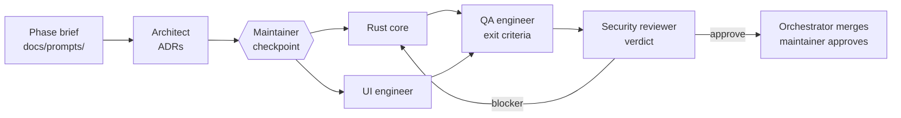

# AI-assisted development workflow

Mooring is developed by a human maintainer working with AI coding agents
([Claude Code](https://claude.com/claude-code)). This page explains how that works, so users
and contributors can judge the process for themselves.

## Principles

- **A human decides.** The maintainer sets the scope of each phase, answers every
  "decision needed", approves new dependencies and accepted risks, and merges.
- **Agents have roles, not free rein.** Each agent owns a defined part of the repository and
  may not write outside it. Out-of-scope edits are rejected at merge.
- **Same gates as human code.** Agent changes pass `make check`, CI on three operating systems,
  dependency and secret scanning, and a written security review with veto power.
- **Everything is written down.** Decisions are ADRs, reviews are committed, and every agent
  leaves a handoff note. The repository is the audit trail.

## Roles

The roles are defined in `CLAUDE.md` and `.claude/agents/`.

| Role | Owns | Never |
| --- | --- | --- |
| Orchestrator | Manifests, lockfiles, handoff index, merges | Writes feature code a specialist owns |
| Architect | `docs/adr/**`, interface proposals | Writes implementation |
| Rust core | `crates/**`, `src-tauri/src/**` | Touches the UI or capabilities without security review |
| UI engineer | `apps/desktop/**`, `packages/ui/**` | Calls `invoke()` outside `lib/ipc.ts` |
| Security reviewer | `docs/security/**`, `SECURITY.md`; veto on every PR | Edits source files |
| QA engineer | Tests, test workflows | Weakens a gate |
| Release engineer | Release workflows and scripts, bundle configuration | Commits signing material |

Each role works in its own git worktree, so parallel work cannot collide.

## Flow of a phase

1. The phase brief (`docs/prompts/A1.md` …) lists items and exit criteria.
2. The architect writes or amends ADRs; the maintainer reviews them at a checkpoint.
3. Work is split into PR-sized tasks with explicit file ownership; Rust core and UI work in
   parallel. The UI builds against a mock transport implementing the same IPC interface.
4. QA audits against the exit criteria, adds integration and hostile-input tests, and reports
   bugs with failing tests.
5. The security reviewer reviews the whole diff, updates the threat model and issues a
   verdict. Blockers go back to the owning role.
6. The orchestrator merges, updates the handoff index and reports what shipped, what is
   deferred and what needs a decision.

## Handoff notes

Every role writes `docs/handoff/<phase>-<role>.md` with four sections: **Done**, **Left
open**, **Decision needed**, **Test evidence**. The [index](../handoff/index.md) lists them
newest first. They record commands run and their results, so claims can be checked.

## What this means for contributors

You do not need AI tools to contribute. Human pull requests follow the same rules and go
through the same review. If you use AI assistance yourself, you are responsible for the
change: understand it, test it, and follow the [coding standards](coding-standards.md).
