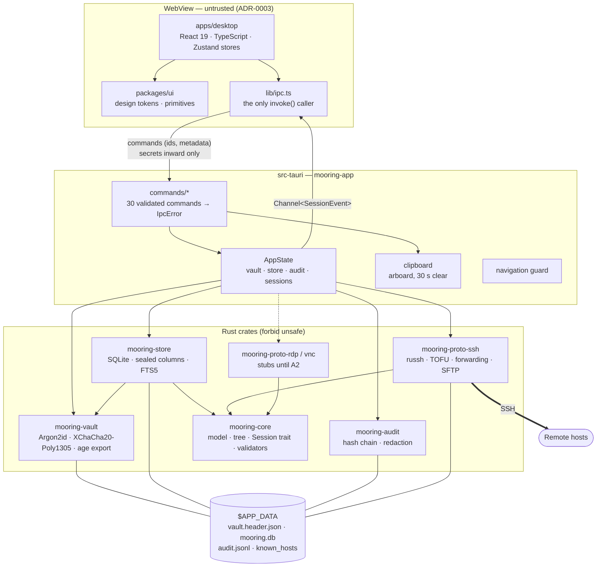

# Architecture overview

Mooring is a [Tauri 2](https://tauri.app/) application: a Rust core that owns every secret,
protocol and file, and a React user interface rendered in the operating system's WebView.
The decision and alternatives are in [ADR-0001](../adr/0001-tauri-rust-react.md).

## Components



## Trust boundary

The WebView is treated as untrusted ([ADR-0003](../adr/0003-trust-boundaries.md)):

- Secrets cross IPC **inward only** (master password, a new credential secret, a prompt
  answer). No command returns a secret. The UI works with credential ids.
- Every command validates and caps its input and maps errors to `IpcError { code, message }`
  with stable codes and no secret or internal detail.
- The `main` window has the `core:default` capability only: no shell, file system, HTTP or
  opener plugins. CSP is `default-src 'self'`; `freezePrototype` is on.
- The main window refuses navigation away from the app origin and new windows; terminal
  hyperlinks are inert.
- Remote web content (Phase A2) gets its own window label and a narrower capability.

## Data flow: opening an SSH session

1. The UI calls `session_open({ connectionId, size, onEvent })` with a Tauri channel.
2. The command resolves the effective credential through the folder tree
   (`mooring_core::tree`, [ADR-0005](../adr/0005-storage.md)), opens the sealed secret with the
   unlocked vault, audits `credential_used`, and builds `ConnectParams`.
3. `mooring-proto-ssh` connects, checks the host key against `known_hosts`, and emits
   `SessionEvent::Prompt { purpose: host_key_trust }` for an unknown host.
4. The UI shows the dialog and answers through `session_send(Answer)`. The Rust side stores
   the key (hashed) and audits the decision.
5. Authentication runs; the secret is dropped after the auth round
   ([ADR-0004](../adr/0004-session-abstraction.md), [ADR-0007](../adr/0007-ssh-trust-and-algorithms.md)).
6. Terminal output streams as base64 `Bytes` events over the channel with back-pressure;
   input goes back through `session_send`.

## Storage

All state lives in the platform application data directory:

| File | Contents |
| --- | --- |
| `vault.header.json` | Authenticated header: KDF params, salt, wrapped data key, `vault_id` |
| `mooring.db` | SQLite: folders, connections, tags, credentials (secret columns sealed), FTS index |
| `audit.jsonl` | Hash-chained audit log |
| `known_hosts` | Trusted SSH host keys, OpenSSH format |

The data directory is created `0700` and files `0600` on Unix.

## Repository layout

```text
crates/
  mooring-core/        domain model, tree + inheritance, validators, Session trait
  mooring-vault/       KDF, AEAD, header, calibration, auto-lock policy, keyring wrap, age export
  mooring-store/       SQLite schema, migrations, sealed columns, FTS5 search
  mooring-audit/       hash-chained JSONL log, verify, redaction
  mooring-proto-ssh/   russh client: trust, auth, algorithms, shell, forwarding, SFTP
  mooring-proto-rdp/   stub (Phase A2)
  mooring-proto-vnc/   stub (Phase A2)
src-tauri/             Tauri shell: commands, state, clipboard, navigation, capabilities
apps/desktop/          React UI (components, stores, lib/ipc.ts, styles)
packages/ui/           design tokens and CSS primitives
tests/vectors/         reference verification of vault vectors with the age CLI
docs/
  adr/                 Architecture Decision Records
  security/            threat model and phase reviews
  handoff/             per-role notes for each phase
  prompts/             phase briefs (A1–A4)
  user-guide/          end-user documentation
  developer-guide/     this guide
.github/               CI, security and vector workflows, templates, Dependabot
.claude/               agent role definitions and commands (AI-assisted workflow)
Makefile               single entry point: setup, dev, check, test, audit, bundle
```

## Key design records

| ADR | Topic |
| --- | --- |
| [0001](../adr/0001-tauri-rust-react.md) | Tauri 2 + Rust core + React UI |
| [0002](../adr/0002-vault-cryptography.md) | Vault cryptography |
| [0003](../adr/0003-trust-boundaries.md) | Trust boundaries and IPC rules |
| [0004](../adr/0004-session-abstraction.md) | Session trait and events |
| [0005](../adr/0005-storage.md) | SQLite with sealed columns |
| [0006](../adr/0006-vault-lifecycle.md) | Calibration, auto-lock, keyring wrap, export |
| [0007](../adr/0007-ssh-trust-and-algorithms.md) | SSH trust, authentication, algorithms |
| [0008](../adr/0008-a1-ipc-contract.md) | A1 IPC contract |
| [0009](../adr/0009-credential-model.md) | Typed credential model |
